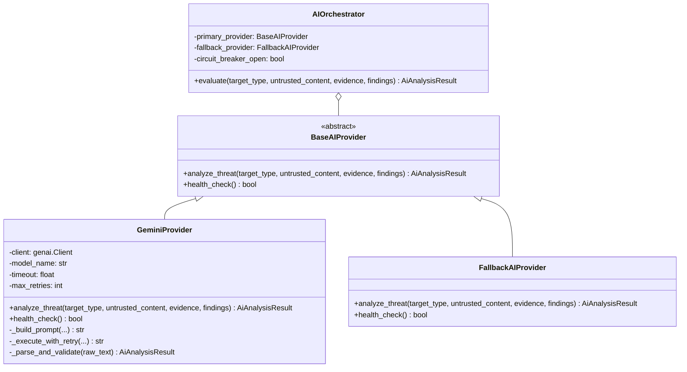

# PHASE 03 ARCHITECTURE: 01 — AI COMPONENT ARCHITECTURE & PROVIDER ABSTRACTION

**Document Version:** 1.0.0  
**Project:** CyberShield AI 2.0  
**Phase:** 03 — AI Integration  
**Status:** Approved for Planning  

---

## 1. Class & Interface Architecture

---

## 2. Component Decoupling Strategy

1. **`BaseAIProvider` (`backend/app/engines/ai/base.py`):**
   - Pure abstract interface declaring asynchronous `analyze_threat` method.
   - Accepts sanitized payload dictionaries, returns strongly-typed `AiAnalysisResult`.

2. **`GeminiProvider` (`backend/app/engines/ai/client.py`):**
   - Implements `BaseAIProvider` using the official `google-genai` SDK.
   - Encapsulates secret key handling, rate-limit backoff, and JSON response extraction.

3. **`FallbackAIProvider` (`backend/app/engines/ai/fallback.py`):**
   - Implements `BaseAIProvider` with zero network dependency.
   - Synthesizes clean explanations directly from deterministic findings when the remote LLM is unavailable.

4. **`AIOrchestrator` (`backend/app/services/ai_service.py`):**
   - Manages timeouts, provider switching, circuit breakers, and status propagation.
