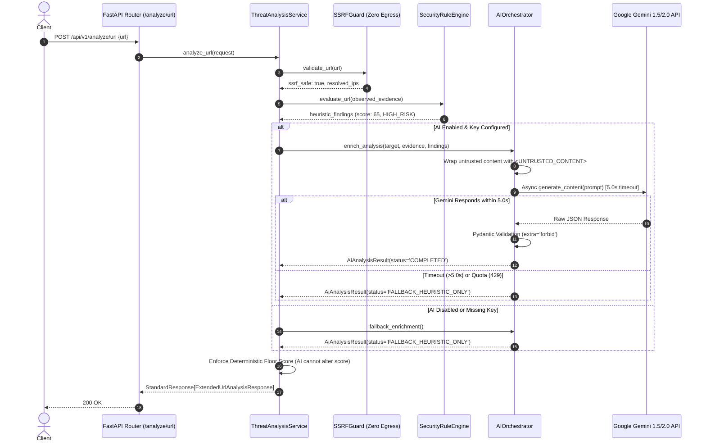

# PHASE 03 ARCHITECTURE: 02 — DATA FLOW & PROMPT ISOLATION SPECIFICATION

**Document Version:** 1.0.0  
**Project:** CyberShield AI 2.0  
**Phase:** 03 — AI Integration  
**Status:** Approved for Planning  

---

## 1. End-to-End Analysis Data Flow

