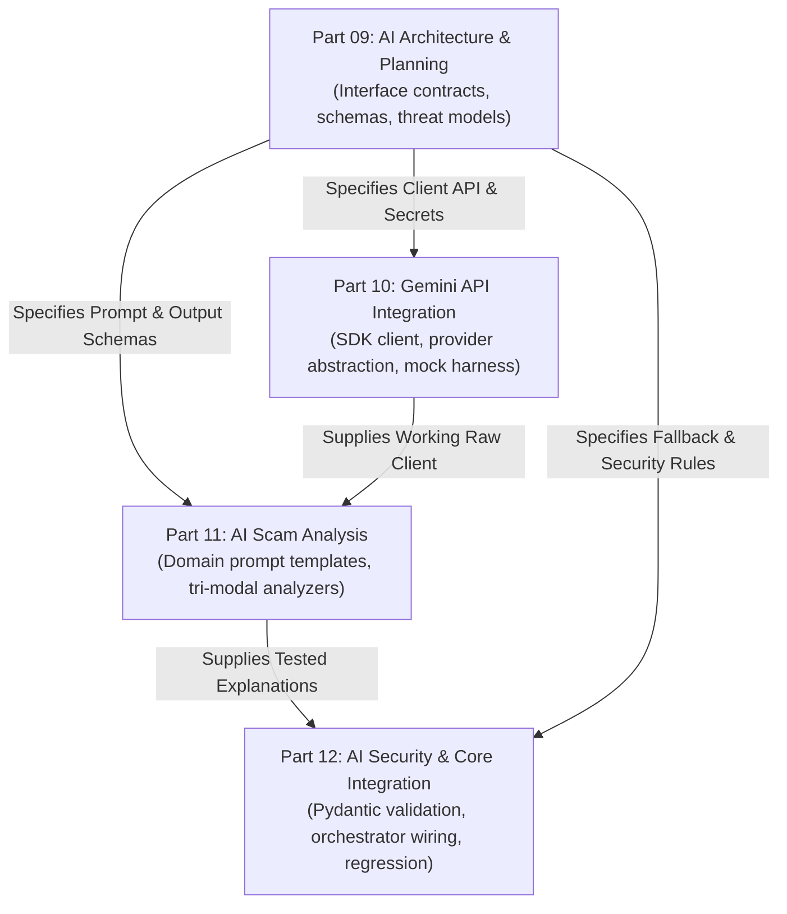

# CYBERSHIELD AI 2.0 — PHASE 03 DEPENDENCY MAP

**Document Version:** 1.0.0  
**Project:** CyberShield AI 2.0  
**Workspace:** `D:\Adamas offline Hackathon`  
**Current Date:** 2026-11-14T10:34:00+05:30  
**Phase Status:** **PLANNED (AWAITING HUMAN AUTHORIZATION)**  

---

## 1. Upstream Frozen Dependencies

Phase 03 strictly consumes Phase 01 and Phase 02 artifacts as read-only frozen dependencies:

```text
[PHASE 01: FROZEN]
  ├── backend/app/core/config.py (Settings, SecretStr, gemini_api_key placeholder)
  ├── backend/app/core/logging.py (Secret scrub log filter)
  ├── backend/app/core/security.py (mask_secret helper)
  └── backend/app/schemas/common.py (StandardResponse envelope)

[PHASE 02: FROZEN]
  ├── backend/app/schemas/analysis.py (RiskLevel, SecurityIndicator, HeuristicFindings)
  ├── backend/app/schemas/url.py (UrlAnalysisRequest)
  ├── backend/app/schemas/email.py (EmailAnalysisRequest)
  ├── backend/app/schemas/sms.py (SmsAnalysisRequest)
  ├── backend/app/utils/sanitizer.py (normalize_target_url, sanitize_input_text)
  ├── backend/app/engines/ssrf_guard.py (Zero-egress SSRF Guard)
  ├── backend/app/engines/rules/ (Deterministic Rules Engine)
  └── backend/app/services/threat_service.py (Base Orchestration Service)
```

---

## 2. Internal Phase 03 Dependency Sequence

Phase 03 parts have a strict linear dependency hierarchy. No Part may commence until its parent dependencies are approved and frozen:



---

## 3. External Third-Party Runtime Dependencies

| Library / Package | Version Range | Purpose | Part Introduced | License |
|---|---|---|:---:|---|
| `google-genai` | `>=0.1.1,<1.0.0` | Official Google GenAI Python SDK for Gemini 2.0 / 1.5 | Part 10 | Apache-2.0 |
| `pydantic` | `>=2.7.0,<3.0.0` | Strict output schema parsing & extra="forbid" validation | Frozen (P1) | MIT |
| `httpx` | `>=0.27.0,<1.0.0` | Async HTTP client for provider transport & timeouts | Frozen (P1) | BSD-3-Clause |
| `pytest-asyncio` | `>=0.23.0` | Async unit test execution for Gemini mock fixtures | Frozen (P1) | Apache-2.0 |

*Policy: Dependency installation will occur strictly during Part 10 under isolated virtual environment control.*

---

## 4. Subsystem Coupling & Isolation Matrix

| Subsystem | Deterministic Heuristic Engine | AI Reasoning Engine | SSRF Guard Firewall | API Transport Layer |
|---|:---:|:---:|:---:|:---:|
| **Deterministic Engine** | — | **Zero Coupling** (AI cannot alter rules) | Direct Preflight | Clean Output Interface |
| **AI Reasoning Engine** | Consumes findings | — | **Zero Egress** (AI does not fetch URLs) | Clean Extension Payload |
| **SSRF Guard Firewall** | Blocks unsafe targets | **Zero Access** (AI cannot bypass) | — | Throws on violation |
| **Orchestration Service** | Primary Decider | Secondary Enricher | Mandatory Pre-Check | Assembles StandardResponse |
