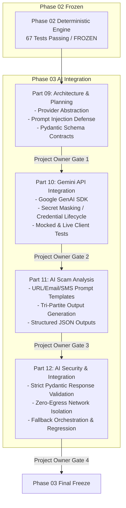

# CYBERSHIELD AI 2.0 — PHASE 03 MASTER ROADMAP
## AI INTEGRATION (PART 09 TO PART 12)

**Document Version:** 1.0.0  
**Project:** CyberShield AI 2.0  
**Workspace:** `D:\Adamas offline Hackathon`  
**Current Date:** 2026-11-14T10:34:00+05:30  
**Current Phase Status:** **PLANNED (AWAITING HUMAN AUTHORIZATION)**  
**Project Owner Approver:** Human Operator  
**Lead Engineer:** Senior Backend Engineer, AI/FastAPI Architect, Application Security Engineer  

---

## 1. Phase 03 Executive Summary & Scope

Phase 03 introduces AI-powered contextual reasoning and social engineering analysis into CyberShield AI 2.0 using the official Google GenAI (Gemini) API.

### Core Mission:
Augment the frozen Phase 01 & Phase 02 deterministic security backend with explainable AI reasoning **without weakening, modifying, or bypassing the deterministic security engine**.

### Scope Boundaries:
- Phase 03 consists of exactly four sequential Parts:
  - **Part 09: AI Architecture & Integration Planning**
  - **Part 10: Gemini API Integration**
  - **Part 11: AI-Based Scam Analysis & Explanation**
  - **Part 12: AI Security, Validation & Core Engine Integration**
- Phase 01 (`PART_01` to `PART_04`) is **FROZEN**.
- Phase 02 (`PART_05` to `PART_10` / Deterministic Engine) is **FROZEN**.
- AI analysis is strictly optional, switchable, and asynchronous.
- If AI credentials are missing, or if the AI engine times out, fails, or is disabled, the system operates seamlessly with pure deterministic findings (`FALLBACK_HEURISTIC_ONLY`).

---

## 2. Phase 03 Part-by-Part Matrix

| Part Identifier | Part Title | Current Status | Prerequisites | Gate Condition |
|---|---|:---:|---|---|
| **PART 09** | AI Architecture & Integration Planning | **AWAITING_HUMAN_VERIFICATION** | Phase 02 Frozen | Self-Verification Passed |
| **PART 10** | Gemini API Integration | **AWAITING_HUMAN_VERIFICATION** | Part 09 Complete | Unit Tests & Mocks Passed |
| **PART 11** | AI-Based Scam Analysis & Explanation | **AWAITING_HUMAN_VERIFICATION** | Part 10 Complete | Tri-Modal Tests Passed |
| **PART 12** | AI Security, Validation & Core Integration | **AWAITING_HUMAN_VERIFICATION** | Part 11 Complete | Full Regression (100P, 2S) |

---

## 3. Strict Sequential Execution Flow

---

## 4. Part 09: AI Architecture & Integration Planning
- **Objective:** Design complete decoupled AI provider architecture, schemas, and security controls before writing production code.
- **Key Tasks:**
  1. Audit existing frozen backend interfaces.
  2. Specify Provider Abstraction (`BaseAIProvider`, `GeminiProvider`).
  3. Define strict tri-partite data separation (`observed_evidence`, `heuristic_findings`, `ai_analysis`).
  4. Design prompt injection defenses (delimiters, strict JSON mode, untrusted boundary tags).
  5. Establish resilience policies (5.0s timeout, exponential backoff, circuit breaker fallback).
- **Deliverables:** Architectural specifications, component diagrams, contract proposals, test strategies.

---

## 5. Part 10: Gemini API Integration
- **Objective:** Build an isolated, testable, and robust Gemini API client.
- **Key Tasks:**
  1. Integrate official Google GenAI SDK (`google-genai`).
  2. Implement `GeminiClient` with secret masking, timeout (5.0s), and retry limits (max 2 retries).
  3. Support non-blocking mock mode for CI/offline environments.
  4. Live API connectivity verification only when `GEMINI_API_KEY` is genuinely provided by user.
- **Deliverables:** `backend/app/engines/ai/client.py`, unit test suite with 100% mocked coverage.

---

## 6. Part 11: AI-Based Scam Analysis & Explanation
- **Objective:** Contextual social engineering and threat intent explanation.
- **Key Tasks:**
  1. Author hardened prompt templates for URL, Email, and SMS threat modalities.
  2. Enforce strict JSON output with fields: `summary`, `explanation`, `supporting_evidence`, `ai_inferences`, `uncertainty_statement`, `user_recommendations`.
  3. Guarantee that AI never fabricates observed evidence or declares unverified targets "confirmed fraudulent".
- **Deliverables:** Prompt generators, contextual inference evaluators, modality test suites.

---

## 7. Part 12: AI Security, Validation & Core Integration
- **Objective:** Seamlessly wire AI capabilities into the core analysis orchestration service without altering Phase 1/2 frozen guarantees.
- **Key Tasks:**
  1. Validate AI responses against `AiAnalysisResult` Pydantic model with `extra="forbid"`.
  2. Ensure AI score or assessment NEVER overrides, dilutes, or lowers deterministic severity floors.
  3. Verify zero outbound HTTP requests occur during AI analysis.
  4. Full regression testing ensuring all 67 baseline tests pass alongside new AI tests.
- **Deliverables:** Orchestrated service integration, security boundary fuzz tests, final freeze readiness.

---

## 8. Non-Negotiable Governance Invariants
1. **Never edit frozen Phase 01 or Phase 02 files.**
2. **Never expose or hardcode API keys.**
3. **Never allow AI to override deterministic risk scores.**
4. **Never execute instructions embedded in analyzed messages.**
5. **Always preserve deterministic fallback during AI failures.**
